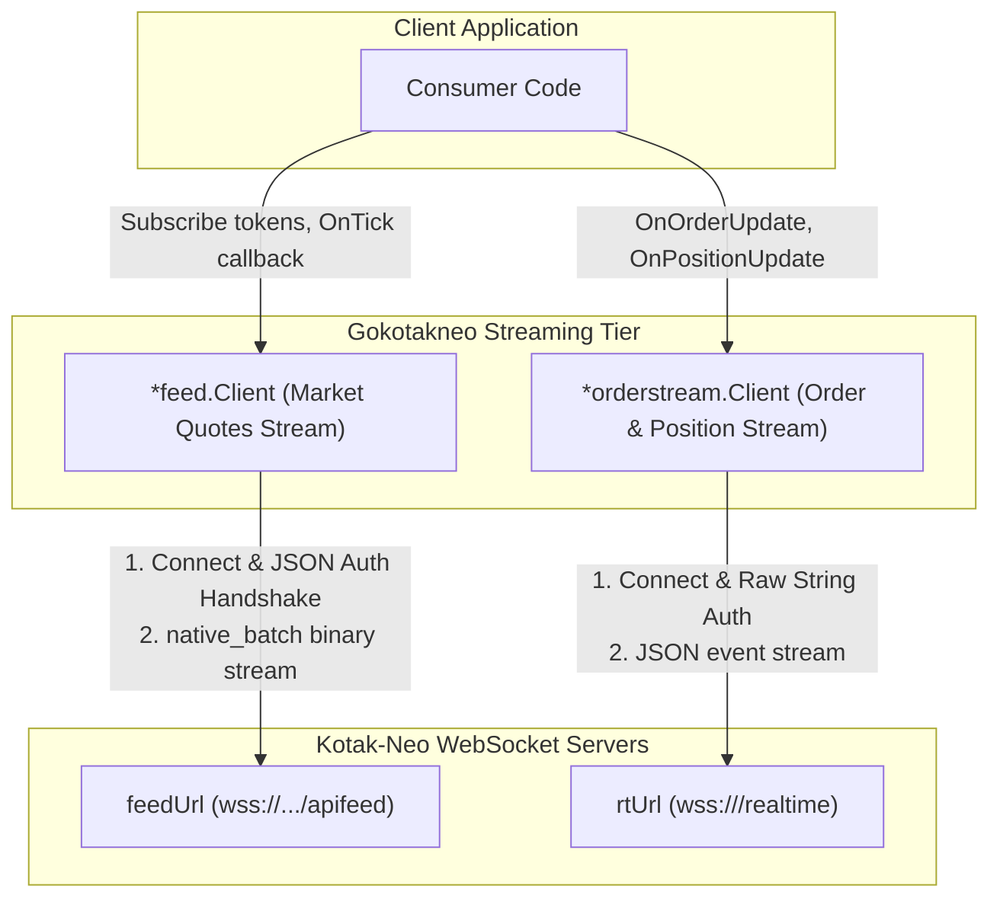

# Phase 5: Dual WebSocket Real-Time Streaming Engines

Part of Gokiteconnect-parity Go SDK for Kotak-Neo (`gokotakneo`).

---

## 1. Scope

Kotak-Neo requires two independent WebSocket streaming clients:

### Engine A: Market Quotes Feed (`feed/`)
- Connects to `data.feedUrl` (`wss://.../apifeed`).
- First message JSON: `{user: "<ucc>", auth: "<sid>", format: "native_batch", source: "NEOTRADEAPI"}`.
- Captures exchange dividers from server authentication acknowledgment.
- Subscribes via JSON commands (`{"type": "subscribe", "instruments": [...]}`).
- De-frames `native_batch` binary packets (little-endian byte order, packed structs).
- Divides integer prices by exchange divider (e.g. 100 for equity, 10000000 for CDS).
- Watchdog timer checking `time.Since(lastActivity) > 5s`.
- Exponential backoff with randomized jitter.
- In-memory subscription cache with auto-resubscription on reconnect.

### Engine B: Order & Position Stream (`orderstream/`)
- Connects to `data.rtUrl` or `wss://<baseurl>/realtime`.
- First message (RAW STRING): `{type:cn,Authorization:<token>,Sid:<sid>,src:WEB}`.
- Receives server ACK: `{"ak": "ok", "type": "cn", "msg": "connected"}`.
- Listens for order lifecycle events (status `COMPLETE`, `REJECTED`, `OPEN`, `CANCELLED`).
- Listens for position exposure updates.
- Auto-reconnect with jitter and watchdog.

---

## 2. Test-Driven Development (TDD) Test Matrix (`feed_test.go` & `orderstream_test.go`)

### A. Market Quotes Binary De-Framing (`feed_test.go`)
| Case Type | Scenario | Expected Behavior |
| :--- | :--- | :--- |
| **Positive: Auth & Divider Storage** | Server sends JSON auth acknowledgement with exchange dividers (`nse_cm: 100`, `cde_fo: 10000000`) | Stores dividers in thread-safe map, marks stream authenticated. |
| **Positive: Single LTP Packet** | Binary frame with LTP packet (4-byte token, 4-byte little-endian scaled price) | Unpacks token, divides integer by exchange divider, fires `OnTick`. |
| **Positive: Full Depth 5x5** | Binary frame with full depth market book | Unpacks 5 bids and 5 asks with correct price scaling and quantities. |
| **Positive: Batched Multi-Packet** | Single binary WebSocket frame containing 10 concatenated tick packets | De-frames all 10 packets cleanly without index-out-of-range panic. |
| **Negative: Corrupted Binary Header** | Truncated binary frame shorter than packet header | Discards safely, triggers `OnError`, does not crash socket loop. |
| **Negative: Unknown Message Code** | Server sends undefined packet type code | Skips unknown packet according to its length header and continues processing next packet. |
| **Edge Case: Zero Divider Fallback** | Exchange divider missing from auth response | Defaults to safe divisor `100.0` rather than dividing by zero. |
| **Edge Case: Reconnection State Recovery** | Socket drops and reconnects | Re-authenticates and emits cached subscription tokens automatically. |

### B. Order & Position Streaming (`orderstream_test.go`)
| Case Type | Scenario | Expected Behavior |
| :--- | :--- | :--- |
| **Positive: Raw Handshake** | Socket opens | Dispatches raw non-JSON string `{type:cn,Authorization:...,Sid:...}`. |
| **Positive: Order Update Event** | Pushed JSON order fill update | Unmarshals into `OrderUpdate` struct and fires `OnOrderUpdate`. |
| **Positive: Position Update Event** | Pushed live position MTM update | Fires `OnPositionUpdate`. |
| **Negative: Connection Drop** | Server forcibly closes connection | Watchdog detects termination, starts exponential backoff with jitter. |
| **Edge Case: Heartbeat Ping/Pong** | Server sends ping frames | Automatically replies with pong, updates `lastActivity` timestamp. |
